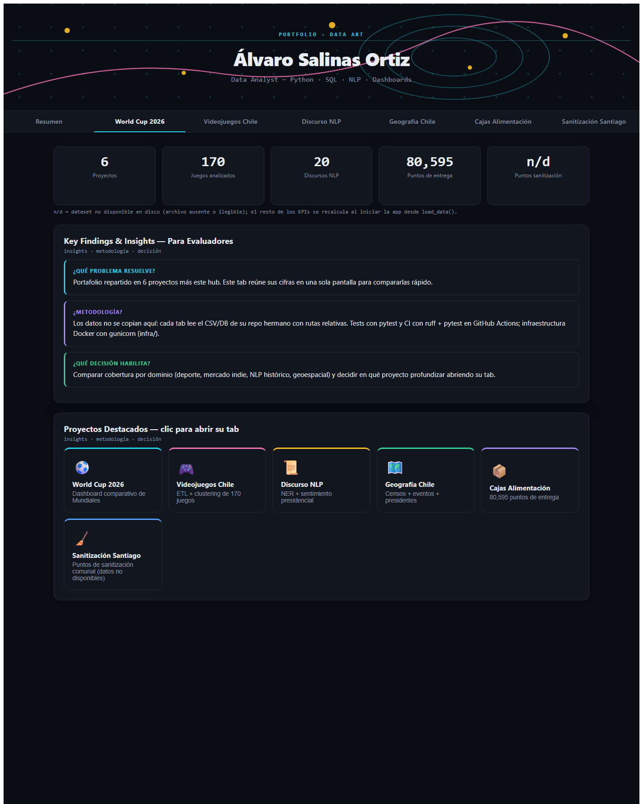

# master-dashboard — hub del portafolio

**Hallazgo (auditoría 2026-10):** este repo no tenía README, y los KPIs del tab *Resumen*
estaban escritos a mano en `app.py` (7 proyectos, 150+ juegos, 87 puntos de sanitización)
mientras los datos reales dan 6, 170 y n/d. Hoy todas las cifras del *Resumen* salen de
`load_data()` (función `overview_kpis()`); si un dataset no está disponible, la tarjeta
muestra `n/d` en lugar de inventar un número.

## KPIs del tab *Resumen* (calculados desde `load_data()`)

| KPI | Valor |
| --- | --- |
| Proyectos (tabs de proyecto) | 6 |
| Juegos analizados | 170 |
| Discursos NLP | 20 |
| Puntos de entrega (cajas) | 80,595 |
| Puntos de sanitización | n/d — repo archivado, datos retirados por privacidad |

```powershell
# mismas cifras que muestra el tab Resumen
.venv\Scripts\python -c "from app import overview_kpis; print(overview_kpis())"
# filas por dataset que lee el hub (cifras del 2026-10-20 en esta máquina)
.venv\Scripts\python -c "from app import load_data; print({k: len(v) for k, v in load_data().items()})"
```

Salida del segundo comando: `wc_matches` 104, `wc_teams` 48, `games` 170, `speeches` 20,
`census` 42, `events` 24, `presidents` 41, `cajas` 80,595, `sanit` no cargado (archivo
ausente). Las cifras se recalculan en cada arranque desde los archivos de los repos
hermanos; las tablas de este README son instantáneas del 2026-10-20 y pueden quedar
desfasadas si esos archivos cambian.

## Qué es

Índice de navegación del portafolio: una app Dash de un solo archivo (`app.py`) con un tab
por proyecto. **No es un análisis nuevo**: no calcula métricas propias ni modelos, solo
lee los CSV/DB que ya viven en los repos hermanos y los presenta en una sola pantalla.

## Captura



## Tabs y repos fuente

| Tab | Repo fuente (hermano de este repo) | Archivo leído |
| --- | --- | --- |
| Resumen | este repo | — (agrega los 6 proyectos) |
| World Cup 2026 | `worldcup-2026` | `data/worldcup.db` (tablas `matches`, `teams`) |
| Videojuegos Chile | `chilean-videogames-analysis` | `data/processed/games.csv` |
| Discurso NLP | `geopolitica-textual-nlp` | `data/processed/speeches.csv` |
| Geografía Chile | `chile-geografia-historica` | `data/processed/{census,events,presidents}.csv` |
| Cajas Alimentación | `cajas-alimentacion` | `data/raw/coordinates.csv` |
| Sanitización Santiago | `sanitizacion-santiago` | `data/raw/sanitization_points.csv` (ausente: repo archivado) |

## Qué mide y qué no

**Qué mide**

- Cifras descriptivas de los 6 proyectos con tab (conteos, períodos, distribuciones),
  calculadas al vuelo desde los archivos del repo hermano correspondiente.
- Degrada por archivo: si falta o falla la lectura de un dataset, ese tab muestra
  *Data not available* y su KPI muestra `n/d`; el motivo se registra con `logging` y el
  resto de la app sigue funcionando (hay un try/except por dataset en `load_data()`,
  probado en `tests/test_load_data.py`).
- Rutas relativas: `BASE = Path(__file__).parent.parent`, así que los repos hermanos se
  resuelven desde el directorio padre del repo (que no es un repositorio git); 6 de ellos
  aportan los archivos que este hub lee.

**Qué no mide**

- No es un análisis nuevo: no calcula métricas propias, no entrena modelos y no filtra
  datasets entre dominios ni entre tabs.
- No hay cross-filtering ni drill-down: los clics en las tarjetas de proyecto cambian de
  tab (navegación), y los clics en los gráficos solo muestran un texto con el repo donde
  vive el detalle. Nada filtra datos dentro de la app.
- No persiste estado ni historial, y no valida la calidad de los datos (eso vive en los
  tests de cada repo hermano).
- No cubre los demás repos del directorio padre (sports analytics, web, etc.): solo los
  6 proyectos listados arriba.

## Fuentes y licencias

| Tab | Repo fuente | Licencia del código | Fuente de los datos (declarada en ese repo) |
| --- | --- | --- | --- |
| World Cup 2026 | `worldcup-2026` | MIT | `openfootball/worldcup` (CC0-1.0) |
| Videojuegos Chile | `chilean-videogames-analysis` | MIT | scraping de Steam API e Itch.io (uso analítico) |
| Discurso NLP | `geopolitica-textual-nlp` | MIT | corpus de la Biblioteca del Congreso Nacional de Chile |
| Geografía Chile | `chile-geografia-historica` | MIT | ver «Data sources and licenses» de ese repo |
| Cajas Alimentación | `cajas-alimentacion` | MIT | programa Cajas de Alimentación (ese README no declara licencia de los datos crudos) |
| Sanitización Santiago | `sanitizacion-santiago` | MIT | datos retirados por privacidad; repo archivado |

Este hub no duplica ni redistribuye los datos: solo los lee. La licencia de este repo es
MIT (ver [LICENSE](LICENSE)); las licencias de los datos crudos se declaran —cuando
existen— en el README de cada repo hermano.

## Reproducción exacta

Requisitos: Python 3.12 y los repos hermanos en el mismo directorio padre (el directorio
padre no es un repositorio git; por eso `infra/` versiona la infraestructura aquí).

```powershell
# 1. entorno (nunca con el Python del sistema si es 3.15)
py -V:Astral/CPython3.12.14 -m venv .venv
.venv\Scripts\python -m pip install -r requirements.txt -r requirements-dev.txt

# 2. app → http://localhost:8050
.venv\Scripts\python app.py

# 3. verificación (deben pasar en verde)
.venv\Scripts\python -m pytest -q
.venv\Scripts\python -m ruff check .
.venv\Scripts\python -m ruff format --check .
```

Sin los repos hermanos en disco la app arranca igual: todos los tabs muestran
*Data not available* y los KPIs del *Resumen* quedan en `n/d`.

Despliegue con Docker (hub en `:8080`, 8 servicios): ver [infra/README.md](infra/README.md).

## Estructura

- `app.py` — la app Dash (layout, tabs, callbacks, `load_data()`).
- `tests/` — pytest: helpers, KPIs derivados de datos, degradación de carga, tabs.
- `infra/` — `docker-compose.yml` (8 servicios), `nginx.conf`, `Dockerfile.base`.
- `ARCHITECTURE.md` — arquitectura real y flujo de datos.
